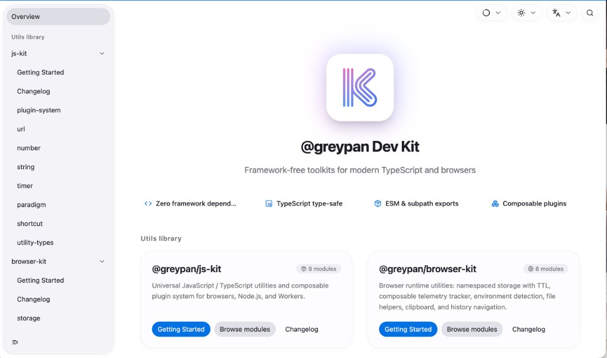

# Dev Kit Demo

这是 `@greypan/js-kit` 与 `@greypan/browser-kit` 的文档与交互示例站。



**在线演示：** [Dev Kit Demo](https://pan-z2l0ahvi.github.io/mono/dev-kit-demo)

公共 API 与类型以 [`packages/js-kit`](../../packages/js-kit) 和 [`packages/browser-kit`](../../packages/browser-kit) 的源码、文档和测试为准，demo 行为不替代公共契约。

## 运行

在仓库根目录启动该 demo 及其 workspace 依赖：

```bash
pnpm dev:dev-kit-demo
```

## 语言与语料

- 站点支持 `zh-CN` 与 `en`，与 `web-ui` demo 共用 `localStorage['locale']`。
- 壳文案在 `.vue` 中写中文原文，经 `@greypan/wuchale-vue` 提取到 `src/locales/*.po`。
- 模块文档、CHANGELOG 与 README 来自 `packages/js-kit`、`packages/browser-kit`、`packages/deps-reload` 与 `packages/unplugin-web-components`，由 `@greypan/md-to-meta` 生成到 `src/generated/`（`exec: []`），不要手改；站内文档键统一带包命名空间。
- 定制交互面板通过 `src/demos/registry.ts` 按 `${pkg}/${module}#${demoId}` 挂载（标识来自围栏 `meta`，如 `demo=parse-url`）；`history-nav` 沙盒位于独立纯 TS 多页入口 `sandbox/history-nav.html`（排除出 `wuchale` 与 `unplugin-auto-import`）。
