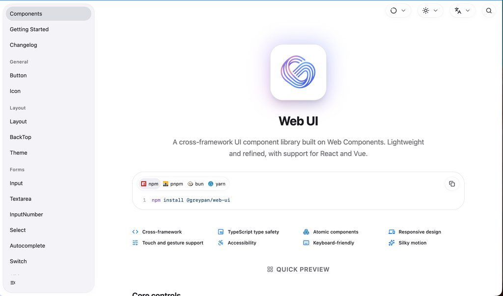

# React Web UI Demo

English | [简体中文](./README.CN.md)

React integration and preview app for `@greypan/web-ui`. It showcases component usage in a real React application with interactive previews.



**Live Demo:** [React Web UI Demo](https://pan-z2l0ahvi.github.io/mono/react-web-ui-demo)

Public properties, slots, events, and types are defined by the source code, README, and tests in [`packages/web-ui`](../../packages/web-ui); demo behavior does not replace the public contract.

## Run

Start the demo and its workspace dependencies from the repository root:

```bash
pnpm dev:react-web-ui-demo
```

Do not run package-local `pnpm dev` alone to verify cross-package integration, as it does not build or watch local workspace dependencies. See [`CONTRIBUTING.md`](../../CONTRIBUTING.md) for environment setup.

## Development Notes

- Example code, API tables, and home docs are generated into `src/generated/` from `packages/web-ui/docs/*.md` and `packages/web-ui/README*.md` by `@greypan/md-to-meta`. Do not edit generated files by hand; dev and build regenerate them automatically after Markdown changes.
- Routes are defined by `src/routes/**` and `vite.config.ts`—do not hand-edit `src/routeTree.gen.ts`. App shell state and route progress reuse `@greypan/doc-demo-kit` and `@greypan/route-progress`.
- UI copy is authored in Chinese in source files, with translations in `src/locales/<locale>.po`. Run `pnpm exec wuchale --clean` in the app directory after adding or removing copy.

See [`AGENTS.md`](./AGENTS.md) in the same directory for more details.
