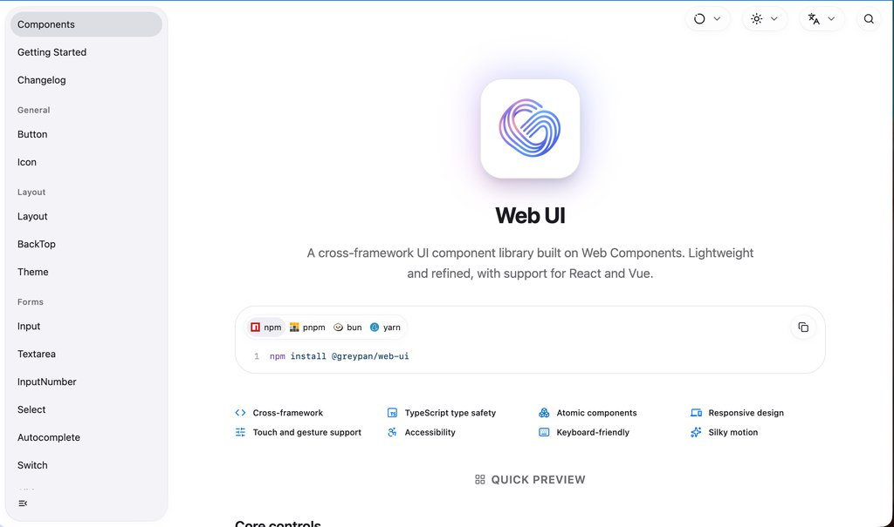

# Vue Web UI Demo

English | [简体中文](./README.CN.md)

Vue integration and preview app for `@greypan/web-ui`. It showcases component usage in a real Vue application with interactive previews.



**Live Demo:** [Vue Web UI Demo](https://pan-z2l0ahvi.github.io/mono/vue-web-ui-demo)

Public properties, slots, events, and types are defined by the source code, README, and tests in [`packages/web-ui`](../../packages/web-ui); demo behavior does not replace the public contract.

## Run

Start the demo and its workspace dependencies from the repository root:

```bash
pnpm dev:vue-web-ui-demo
```

Do not run package-local `pnpm dev` alone to verify cross-package integration, as it does not build or watch local workspace dependencies. See [`CONTRIBUTING.md`](../../CONTRIBUTING.md) for environment setup.

## Localization and Copy

The site supports `zh-CN` and `en` without locale-prefixed routes. The locale selector shares `localStorage['locale']` with the React demo: a valid saved preference takes precedence, followed by the browser locale, defaulting to English.

UI copy is authored in Chinese inside SFCs and transformed before compilation by the private [`@greypan/wuchale-vue`](../../packages/wuchale-vue/README.md) adapter without hand-written translation calls. After adding or removing shell copy, extract and fill in the English PO file in this app directory:

```sh
mise exec -- pnpm exec wuchale --clean
```

PO files are the committed translation source. Body copy, API tables, examples, and home docs come from `packages/web-ui/docs/*.md` and `packages/web-ui/README*.md`, generated into `src/generated/` by `@greypan/md-to-meta`—do not edit generated files by hand.

## Development Notes

- Example code, API tables, and home docs are generated into `src/generated/` from `packages/web-ui/docs/*.md` and `packages/web-ui/README*.md`, and regenerated by the Vite plugin during dev or build after Markdown changes.
- App shell state and route progress reuse `@greypan/doc-demo-kit` and `@greypan/route-progress`.
- Use `WebUiEvent` uniformly for named handler event types instead of hand-writing host types.

See [`AGENTS.md`](./AGENTS.md) in the same directory for more details.
